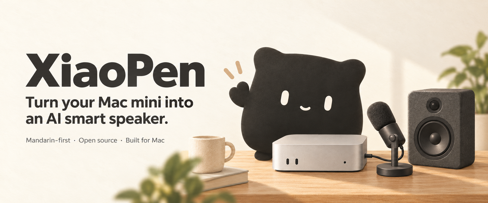

<p align="center">
  <a href="README.md">English</a> · <strong>简体中文</strong>
</p>

<p align="center">
  
</p>

<h1 align="center">小喷</h1>
<p align="center"><strong>把 Mac mini 变成智能音箱助手</strong></p>
<p align="center">接上麦克风 · 自己选大脑 · 叫一声就能聊</p>

<p align="center">
  <a href="https://github.com/jiaqianjing/xiaopen-mac/releases"></a>
  
  
  
  <a href="LICENSE"></a>
</p>

<p align="center">
  <a href="https://github.com/jiaqianjing/xiaopen-mac/releases">下载</a> ·
  <a href="#installation">安装</a> ·
  <a href="#brain">选择大脑</a> ·
  <a href="#privacy">隐私</a>
</p>
<p align="center"><sub>横幅为概念插画；当前应用界面为简体中文，语音工作流以普通话为主。</sub></p>

---

给家里已有的 **Mac mini 接上麦克风**，装上小喷并完成配置，就能把它用成一个接入大模型的智能音箱助手。小喷是免费开源的原生 macOS 应用，常驻菜单栏；其他符合要求的 Apple 芯片 Mac 也可以使用。

这个语音助手的 **“大脑”由你选**。已有 ChatGPT 订阅，可以登录后复用现有订阅额度，不需要另外配置聊天 API Key；也可以使用 DeepSeek、Kimi、Claude 等模型服务、兼容 API 或本机 Ollama。

第三方模型和云端语音识别可能收费，ChatGPT 订阅有额度与网络访问要求，聊天订阅不包含云端识别费用。唤醒词在本机识别，问题默认使用千问云端识别，也可切换为本机识别；具体数据流见[隐私说明](docs/PRIVACY.md)。

## 🏡 在家里怎么用

叫一声 **“小喷小喷”**，从日常的一句话开始：

| 🌦 **出门前问天气**<br>“明天会下雨吗？” | ⏰ **做饭时定提醒**<br>“十分钟后提醒我关火。” |
| :--- | :--- |
| 🔉 **手不方便操作时调音量**<br>“音量调到 40%。” | 💬 **随口问，再接着聊**<br>“换个更简单的说法。” |

回答后可以继续追问，不用每句话都重新叫醒。当前功能围绕天气、提醒、Mac 系统音量和聊天；尚不支持直接接管旧智能音箱或控制全屋家电。

## ✨ 能做什么

- **复用 ChatGPT 订阅**：用 ChatGPT 账号登录，让语音问答使用已有订阅额度，不需要另外配置聊天 API Key。需要能访问 openai.com，受账号额度限制。
- **选择自己的大模型**：内置千问 AI 平台、DeepSeek、Kimi、MiniMax、智谱 GLM、火山方舟（豆包）、OpenRouter、Anthropic Claude，也可以接任何 OpenAI 兼容或 Anthropic 兼容接口，以及本机 Ollama。支持的模型默认关闭深度思考或使用低思考强度；可调整的选项取决于平台与模型。
- **联网搜索**：使用千问 AI 平台时可开启，问新闻、比赛、行情等最新信息也能答。
- **天气**：“明天会下雨吗？”“北京后天冷不冷？”自动定位所在城市，数据来自 Open-Meteo。
- **提醒和计时**：“十分钟后提醒我关火”“明天早上八点叫我起床”“我有哪些提醒”。在本机执行，重启后不丢。
- **系统音量**：“音量调到 40%”“静音”。在本机执行，不经过模型。
- **语音打断**：使用云端识别并开启回声消除时，小喷说话或思考时，可以直接开口打断、问新问题；也可以设成说唤醒词才打断。本机识别模式支持唤醒词打断。使用蓝牙麦克风输入时，语音打断不可用；语音唤醒需保持开启。
- **连续对话**：回答完可以直接接着问，不用再叫唤醒词。
- **全局快捷键 `⌥⌘K`**：在任何应用里开始说话、提前发送或打断回答。
- **自然语音（可选）**：在应用内下载 Qwen3-TTS 模型（约 3.1 GB），在本机 GPU 上生成更自然的朗读声音。

<a id="installation"></a>

## 🚀 安装与搭建

**要求：macOS 14 或更新，Apple 芯片（M 系列）的 Mac。**

### 准备你的 Mac mini

| 准备项 | 怎么做 |
| :--- | :--- |
| 🎙 麦克风 | Mac mini 没有内置麦克风，需要连接能被 macOS 识别的外接麦克风，在“系统设置 → 声音 → 输入”中选好输入设备。 |
| 🔊 声音输出 | 使用 Mac mini 内置扬声器，或在系统声音设置中选择连接好的扬声器。 |
| 🌙 运行状态 | 使用时保持 Mac 处于唤醒状态，小喷正在运行并开启语音唤醒。拾音距离和效果取决于麦克风、摆放位置与环境。 |

### 安装小喷

1. 从 [Releases](https://github.com/jiaqianjing/xiaopen-mac/releases) 下载最新的 `XiaoPen-x.y.z.dmg`，把小喷拖进“应用程序”。
2. 当前版本尚未经过苹果公证。首次打开时如果提示“无法验证开发者”：在“应用程序”里 **右键点击小喷 → 打开 → 打开**；或在“系统设置 → 隐私与安全性”底部点击“仍要打开”。只需要一次。
3. 跟着首次使用引导完成麦克风、语音识别授权，在“系统设置 → 键盘 → 听写”中开启普通话（中国大陆），供本机识别唤醒词和中文问题。
4. 按[下面的说明](#brain)选择“大脑”，在“设置 → 通用”选择问题的语音识别方式。默认云端识别使用千问 API Key；未配置密钥或网络出错时，会自动改用本机识别。
5. 试喊“小喷小喷”，问一个问题，再接着追问，确认麦克风与声音输出正常。

<a id="brain"></a>

## 🧠 选择它的“大脑”

### 已有 ChatGPT 订阅

在“设置 → 大脑”选择 **“ChatGPT 订阅”**，按提示在浏览器中登录并授权，再选择模型。回答会使用你的订阅额度，不需要另外配置聊天 API Key；需要能访问 openai.com。

**语音识别是独立的一步。** 如果要使用默认的千问云端识别，先在“设置 → 大脑”选择“千问 AI 平台”并填写 API Key，再切回“ChatGPT 订阅”；识别会继续使用保存的千问密钥，可能产生识别费用。也可以在“设置 → 通用”选择本机识别。

### 使用模型 API

在“设置 → 大脑”中选择平台，通过界面中的控制台链接获取 API Key，再填写密钥与模型。语音对话可优先选择平台当前提供的快速模型，具体名称以控制台为准。密钥只保存在 macOS 钥匙串中。

### 使用本机 Ollama

在 Mac 上运行 Ollama 并准备好模型后，在“设置 → 大脑”中选择本机 Ollama，按界面配置服务地址和模型。模型在本机回答；问题的语音识别仍由“设置 → 通用”中的选择决定。

<a id="privacy"></a>

## 🔒 隐私与数据流

- **待命**：唤醒词在本机识别，声音不保存为录音文件、不持续上传；短暂音频缓冲只在内存中保留。
- **云端识别问题（默认）**：叫醒后，从唤醒前约 2.5 秒开始到你说完的录音会发送到千问 AI 平台识别。可以在“设置 → 通用”改为完全离线的本机识别。
- **直接开口打断**：使用云端识别并开启“直接说话就能打断”时，约 1 秒预录及后续插话会发送到千问云端，用于确认你是否在说话。本机识别模式不使用这种云端打断确认。
- **模型回答**：识别出的文字和最近的对话上下文会发送给你选择的模型平台，以生成回答；Ollama 在本机运行。
- **天气查询**：城市名和约 1 公里精度的坐标会发送给 Open-Meteo。
- **记录**：对话只保存在内存里，退出、清空或切换模型时清除；提醒保存在本机，API Key 与 ChatGPT 令牌保存在 macOS 钥匙串中。

详见[隐私说明](docs/PRIVACY.md)。

## 💬 反馈问题

在“设置 → 关于 → 导出诊断信息…”导出日志与配置概要，不含密钥，默认不记录识别文字。如果本次运行开启过“记录识别文字”，分享前请检查导出内容。附在 [Issues](https://github.com/jiaqianjing/xiaopen-mac/issues) 里会很有帮助。欢迎反馈唤醒、断句、连续对话和设备使用中的问题。

## ☕ 支持小喷

小喷是一个人业余维护的开源项目。如果它帮到了你，欢迎请作者喝杯咖啡。

- 爱发电：[afdian.com/a/kenjia](https://afdian.com/a/kenjia)，支持按月赞助。
- 微信 / 支付宝扫码：

<table>
  <tr>
    <td align="center"><br>微信</td>
    <td align="center"><br>支付宝</td>
  </tr>
</table>

也可以在应用的“设置 → 关于 → 支持小喷”里扫码。给项目点个 Star、提交问题和建议，同样是很大的支持。

<a id="development"></a>

## 🛠 开发

```bash
swift test
./scripts/build_app.sh            # 生成 build/XiaoPen-x.y.z.dmg
```

架构、打包、签名与各模块细节见[开发说明](docs/DEVELOPMENT.md)。更新记录见 [CHANGELOG](CHANGELOG.md)。

项目采用 [MIT License](LICENSE)。
